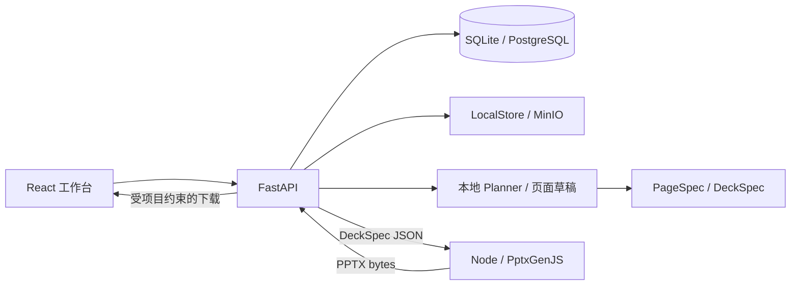

# 基础框架架构

当前实现沿用设计文档的模块边界，优先打通独立可运行的本地流程。模型推理、资料理解与视觉检查尚未接入。



## 数据与契约

业务 DTO 使用 camelCase；`pageJson` 内部统一使用 snake_case，与 Python `PageSpec` 和 Node JSON Schema 一致。Pydantic 是契约源，`scripts/export_schema.py` 导出 Schema，`--check` 检查是否过期。

```json
{
  "schema_version": "1.0",
  "page_no": 1,
  "layout": "two_column",
  "title": "项目进展",
  "subtitle": "本阶段重点",
  "content": [
    {
      "type": "text",
      "title": "已完成工作",
      "text": "由用户填写并核实。",
      "sources": []
    }
  ]
}
```

- 最多 50 页，每页最多 4 个文本块；页码从 1 连续排列。
- 布局支持 `title`、`two_column`、`summary`。主题默认值由共享 Schema 提供。
- 引用包含 `document_id`、`file_name`、可选 `page_no`、`excerpt`。当前页面草稿不自动添加引用；API 支持提交引用并校验项目、文件名和服务端安全等级。自动检索以及摘录真实性核实属于后续 RAG/内容校验工作。
- 模板、项目资料、素材分别存储。关联模板仅保存选择关系，不代表已经解析和应用模板。
- 页面正文保存在 `ppt_page.page_json`，大纲的标题与用途保持原始策划记录。导出时使用 Page JSON 中编辑后的标题。

## API

基础路径为 `/api/ppt`。涉及既有 PPT 的所有接口必须附带 `?projectId=当前项目ID`；文档上传记录和 PPT 任务是不同实体，历史命名保留以兼容已有前端。

| 方法与路径 | 作用 |
| --- | --- |
| `GET/POST /projects` | 列出/创建项目 |
| `GET /projects/{id}` | 读取项目 |
| `GET/POST /projects/{id}/documents` | 项目资料列表/上传 |
| `GET/POST /projects/{id}/assets` | 图片素材列表/上传 |
| `GET/POST /templates` | 共享公司模板列表/上传 |
| `GET /projects/{id}/presentations` | 项目中的 PPT 任务 |
| `POST /documents` | 创建 PPT 任务 |
| `GET /documents/{id}` | 读取任务状态 |
| `GET /documents/{id}/outline` | 读取大纲 |
| `POST /documents/{id}/outline/generate` | 生成或重生成未确认大纲 |
| `POST /documents/{id}/outline/confirm` | 保存编辑结果并确认 |
| `GET /documents/{id}/pages` | 读取页面、版本号及生成状态 |
| `POST /documents/{id}/pages/generate` | 只生成缺失页面，保留已有编辑 |
| `POST /documents/{id}/pages/{pageNo}/generate` | 生成尚未生成的单页 |
| `POST /documents/{id}/pages/{pageNo}` | 用 `{version, page: PageSpec}` 保存单页 |
| `POST /documents/{id}/render` | 同步渲染，持久化 PPTX 后返回下载地址 |
| `GET /documents/{id}/download` | 下载当前内容对应的 PPTX |

未确认大纲、缺少页面或版本冲突返回 409；非法 Page JSON 返回 422；跨项目访问返回 404。无权访问页面引用返回 403；非法新增引用返回 422。渲染器/存储故障返回 503。

## 状态与一致性

```text
DRAFT → OUTLINE_GENERATED → OUTLINE_CONFIRMED → DESIGN_GENERATED
                                                  ↓
                                              RENDERING
                                             ↙         ↘
                                         FAILED      COMPLETED
                                            └─ 重试 ────┘
```

本地页面草稿直接进入 `DESIGN_GENERATED`，未执行真实内容推理、素材选择或视觉 QA。`COMPLETED` 仅表示 PPTX 渲染与保存成功，不代表通过视觉质量评估。

- 页面保存递增 `version`，请求必须匹配当前版本。
- 页面改变时清空当前 PPTX 地址，提交事务后清理旧导出文件。
- 渲染成功前不发布下载地址，返回数据先校验为包含 PPT 核心条目的 ZIP 包。
- 渲染失败保留页面，将任务标记为 `FAILED`，允许原页重试。
- 渲染事务持有数据库写锁，进程中止时回滚临时 `RENDERING` 状态。当前适合个人使用；后续长任务应迁移到带租约和重试的任务队列，避免同步渲染长期占用数据库事务。
- 默认渲染超时 60 秒、产物上限 50 MiB；渲染器 JSON 请求上限 2 MiB。API 在修改任务状态前校验实际 UTF-8 请求字节，超限返回 422，提示缩短摘录或减少引用，保留页面与已有导出状态。

## 安全与存储边界

`projectId` 必须与数据库中 PPT 所属项目一致。来源引用在保存、读取、渲染和下载时检查；安全等级由服务端配置决定，不能通过请求提升权限。文件列表同样按等级过滤。

文件名清理、大小限制、SHA-256、随机对象键及本地路径边界检查由存储模块处理。API 不返回磁盘路径，也不将存储目录直接公开为静态资源。下载使用 `Cache-Control: no-store`。上传仅完成扩展名和体积等基础检查，文件解析是独立后续阶段。

当前不包含身份认证。`projectId` 和安全等级过滤是单用户上下文隔离，不是面向不可信多用户的完整访问控制。Node 渲染器只接收 Page JSON、只监听本机回环地址，不读取用户路径或外部图片 URL。

## 后续接入顺序

1. **文档解析与 RAG**：实现 `DocumentParser`、`Embedder`、`Retriever`，将解析内容写入 `DocumentChunk`；先按 `RetrievalContext.project_id/clearance` 过滤，再排序，输出 `SourceReference`。
2. **公司模板**：解析模板为 `DesignSystem.design_json`，经校验转换为 Theme 和受支持的布局，保留与素材库的分离。
3. **模型与 Agent**：为已有 `Planner` 协议添加模型实现；由服务端配置选择 provider。当前不包含 DeepSeek Harness 依赖、模型调用或密钥配置。
4. **内容与素材**：内容生成消费检索证据，素材选择仅引用实际上传资源；扩展 PageSpec 的同时更新 Renderer。
5. **预览与 QA**：LibreOffice 转 PDF/PNG，再实现 `VisionInspector`；当前网页展示的是结构示意，不是最终 PPT 截图。
6. **长任务与修复**：引入任务表/队列、生成事件、取消和重试，按页保存修改历史，替换当前同步渲染事务。

## 验证边界

Python 测试通过临时 SQLite 和实际 Alembic 迁移验证持久化及权限；API 故障测试替换 Renderer 协议并模拟存储失败。Node 测试实际生成并读取 PPTX ZIP 内容。Playwright 使用独立数据库启动真实三个服务，验证从创建到编辑、下载和刷新恢复的完整流程。

PostgreSQL/MinIO 的 Compose 配置可用于集成环境；本地自动化用 SQLite/LocalStore，不将其结果等同于 PostgreSQL/MinIO 已实测。
