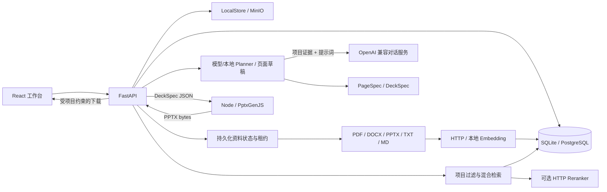

# 基础框架与 Phase 2–4 架构

当前实现沿用设计文档的模块边界，已打通 PPT 基础流程、项目文档解析/RAG、公司模板主题应用与模型大纲规划。Embedding、重排与大纲规划支持实际模型服务；正文生成及视觉检查尚未接入模型。



## 数据与契约

业务 DTO 使用 camelCase；`pageJson` 内部统一使用 snake_case，与 Python `PageSpec` 和 Node JSON Schema 一致。Pydantic 是契约源，`scripts/export_schema.py` 导出 Schema，`--check` 检查是否过期。

```json
{
  "schema_version": "1.0",
  "page_no": 1,
  "layout": "two_column",
  "title": "项目进展",
  "subtitle": "本阶段重点",
  "content": [
    {
      "type": "text",
      "title": "已完成工作",
      "text": "由用户填写并核实。",
      "sources": []
    }
  ]
}
```

- 最多 50 页，每页最多 4 个文本块；页码从 1 连续排列。
- 布局支持 `title`、`two_column`、`summary`。主题默认值由共享 Schema 提供：`Theme` 含主色/背景/文字颜色与标题、正文字体；`DeckSpec.slide_size` 以英寸描述页面尺寸（默认 13.3333×7.5）。
- 公司模板解析为 `TemplateDesign`（`packages/schemas/design.py`：主题配色槽位、标题/正文字体、EMU 页面尺寸、版式清单），存入 `ppt_design_system.design_json`，每次成功解析按版本追加，渲染时最新一行生效；渲染映射为 accent1→主色、lt1→背景、dk1→文字。
- 引用包含 `document_id`、`file_name`、可选 `page_no`、`excerpt`。RAG 引用由服务端从实际分块构建，提供独立来源查看入口。当前页面草稿不自动添加检索引用；手动提交页面引用仍只校验项目、文件名和安全等级，正文事实及手动摘录真实性核实属于后续 Content Agent 工作。
- 模板、项目资料、素材分别存储。关联模板仅保存选择关系，不代表已经解析和应用模板。
- 大纲来源保存在 `ppt_page.outline_sources`（chunkId、文件、位置、≤400 字摘录的快照），规划器与检索提示保存在 `ppt_document_instance.planner/outline_warning`（迁移 0004）。模型只能引用本次检索给出的分块编号，其余编号丢弃；客户端回传的来源快照一律忽略，按编号在项目与权限范围内重建。
- 页面正文保存在 `ppt_page.page_json`，大纲的标题与用途保持原始策划记录。导出时使用 Page JSON 中编辑后的标题。

## API

基础路径为 `/api/ppt`。涉及既有 PPT 的所有接口必须附带 `?projectId=当前项目ID`；文档上传记录和 PPT 任务是不同实体，历史命名保留以兼容已有前端。

| 方法与路径 | 作用 |
| --- | --- |
| `GET/POST /projects` | 列出/创建项目 |
| `GET /projects/{id}` | 读取项目 |
| `GET/POST /projects/{id}/documents` | 项目资料列表/上传 |
| `POST /projects/{id}/documents/{fileId}/process` | 幂等提交解析、失败重试或重新索引 |
| `POST /projects/{id}/search` | 接收 `{query, topK}`，返回来源、分块 ID、排名分数及重排状态 |
| `GET /projects/{id}/documents/{fileId}/chunks/{chunkId}` | 校验项目、安全等级和索引状态后读取原文 |
| `GET/POST /projects/{id}/assets` | 图片素材列表/上传 |
| `GET/POST /templates` | 共享公司模板列表/上传（上传内同步解析主题，失败仍 201 并标记） |
| `POST /templates/{id}/process` | 幂等重试或重新解析模板主题 |
| `POST /projects/{id}/template` | 设置、更换或清除项目关联的公司模板 |
| `GET /projects/{id}/presentations` | 项目中的 PPT 任务 |
| `POST /documents` | 创建 PPT 任务 |
| `GET /documents/{id}` | 读取任务状态 |
| `GET /documents/{id}/outline` | 读取大纲 |
| `POST /documents/{id}/outline/generate` | 生成或重生成未确认大纲；可选 `{feedback, pages}` 以当前编辑结果按意见重排（需模型 Planner） |
| `POST /documents/{id}/outline/confirm` | 保存编辑结果并确认；页面以 `sourceChunkIds` 引用资料，服务端重新校验并保存来源快照 |
| `GET /documents/{id}/pages` | 读取页面、版本号及生成状态 |
| `POST /documents/{id}/pages/generate` | 只生成缺失页面，保留已有编辑 |
| `POST /documents/{id}/pages/{pageNo}/generate` | 生成尚未生成的单页 |
| `POST /documents/{id}/pages/{pageNo}` | 用 `{version, page: PageSpec}` 保存单页 |
| `POST /documents/{id}/render` | 同步渲染，持久化 PPTX 后返回下载地址 |
| `GET /documents/{id}/download` | 下载当前内容对应的 PPTX |

大纲生成期间不持有数据库事务；写回前重新加锁并复核状态，若已被确认则返回 409 且不保存。对话服务不可用或输出两次无效返回 502，原大纲不变；本地 Planner 收到反馈返回 409。未确认大纲、缺少页面或版本冲突返回 409；非法 Page JSON 返回 422；跨项目访问返回 404。无权访问页面引用返回 403；非法新增引用返回 422。渲染器/存储故障返回 503。

## 状态与一致性

项目资料和 PPT 任务使用各自的状态。资料处理链路为：

```text
QUEUED → PARSING → INDEXING → READY
            └── 错误 ────────→ FAILED → 用户重试 → QUEUED
```

上传事务保存文件和 QUEUED 状态；旧 UPLOADED 资料同样可由 worker 接管。后台单机 worker 通过条件更新领取持久化租约，每批 32 个片段；读取文件、解析和模型请求均不持有业务写事务。租约每三分之一周期续期，过期任务可被其他 worker 接管；批次间检查所有权，过期 worker 不再发送新批次，也不能发布结果。正常关闭会释放当前租约并重新排队。

READY 与分块替换在同一事务提交，只有完整索引可参与检索。重复提交处理中任务不会重复入队。重建时旧分块保留但隐藏，失败可重试；SQLite 分块主键使用 AUTOINCREMENT，避免旧来源 URL 命中新建片段。向量模型标识、版本和维度保存在文档上，不混用不同模型的向量。

公司模板链路为：

```text
UPLOADED →（上传内同步解析）→ READY
    └── 解析失败 ──→ FAILED → 用户重试 → 重新解析
```

解析仅读取 PPTX 的 XML（presentation.xml 尺寸、theme 配色与字体、版式清单），不调用模型；失败原因存于 `ppt_template.processing_error`。每次成功解析追加一行 `ppt_design_system`（version 递增），渲染取最新；并发重复解析只会多出同版本行，按 `(version, id)` 倒序取值结果确定。必需配色或字体缺失、文件损坏或加密、页面尺寸越界都判定 FAILED，不虚构主题值。导出时解析项目关联模板：模板安全等级超出当前授权返回 403；未关联、未就绪或 design_json 校验失败回退默认主题，响应的 `themeSource`/`themeName` 说明实际来源，前端据此提示。

PPT 任务链路为：

```text
DRAFT → OUTLINE_GENERATED → OUTLINE_CONFIRMED → DESIGN_GENERATED
                                                  ↓
                                              RENDERING
                                             ↙         ↘
                                         FAILED      COMPLETED
                                            └─ 重试 ────┘
```

本地页面草稿直接进入 `DESIGN_GENERATED`，未执行真实内容推理、素材选择或视觉 QA。`COMPLETED` 仅表示 PPTX 渲染与保存成功，不代表通过视觉质量评估。

- 页面保存递增 `version`，请求必须匹配当前版本。
- 页面改变时清空当前 PPTX 地址，提交事务后清理旧导出文件。
- 渲染成功前不发布下载地址，返回数据先校验为包含 PPT 核心条目的 ZIP 包。
- 渲染失败保留页面，将任务标记为 `FAILED`，允许原页重试。
- 渲染事务持有数据库写锁，进程中止时回滚临时 `RENDERING` 状态。当前适合个人使用；后续长任务应迁移到带租约和重试的任务队列，避免同步渲染长期占用数据库事务。
- 默认渲染超时 60 秒、产物上限 50 MiB；渲染器 JSON 请求上限 2 MiB。API 在修改任务状态前校验实际 UTF-8 请求字节，超限返回 422，提示缩短摘录或减少引用，保留页面与已有导出状态。

## 安全与存储边界

`projectId` 必须与数据库中 PPT 所属项目一致。来源引用在保存、读取、渲染和下载时检查；安全等级由服务端配置决定，不能通过请求提升权限。文件列表同样按等级过滤。

文件名清理、大小限制、SHA-256、随机对象键及本地路径边界检查由存储模块处理。API 不返回磁盘路径，也不将存储目录直接公开为静态资源。下载、检索和原文查看使用 `Cache-Control: no-store`。解析器限制输入、OOXML 解压规模及文本总量；扫描 PDF、空文档、损坏文件和未支持格式返回明确失败原因。

检索先在数据库中限定项目、安全等级、READY 状态及模型版本/维度，再进行向量与关键词排名。PostgreSQL 使用 pgvector 的精确余弦查询；SQLite 在已过滤候选集上计算余弦。当前针对个人资料量使用精确检索，并未建立 HNSW/IVFFlat 索引。关键词支持中文双字词与英文/数字标识，评分是排序信号，不代表事实可信度。

启用重排时，仅向服务发送已过滤的最多 20 个候选片段；返回后再次检查有效分块，避免重建期间发布过期结果。`mode=hybrid-rerank` 表示已完成重排；失败时 `mode=hybrid` 且附带前端展示的 warning。Qwen3 成对评分通过配置添加官方判定模板，服务端已套用模板时应使用 plain 格式。

当前不包含身份认证。`projectId` 和安全等级过滤是单用户上下文隔离，不是面向不可信多用户的完整访问控制。Node 渲染器只接收 Page JSON、只监听本机回环地址，不读取用户路径或外部图片 URL。

## 后续接入顺序

1. **文档解析与 RAG（已实现）**：解析、分块、持久化处理、HTTP/本地 Embedding、项目过滤、混合检索、可选重排和来源查看；后续再扩展 OCR、XLSX、图片语义与大规模索引。
2. **公司模板（已实现主题级）**：解析模板为 `DesignSystem.design_json` 并在导出时转换为 Theme 与页面尺寸；Logo/背景图提取、占位符与字号级布局映射留待后续阶段。
3. **大纲规划（已实现）**：`ModelPlanner` 经 OpenAI 兼容对话服务规划大纲，检索项目证据并只允许引用给定编号，支持按反馈重排；`SLIDEMIND_PLANNER_PROVIDER=local` 回退 `LocalPlanner`。DeepSeek Harness 运行时、流式输出与多 Agent 编排留待后续。
4. **内容与素材**：内容生成消费检索证据，素材选择仅引用实际上传资源；扩展 PageSpec 的同时更新 Renderer。
5. **预览与 QA**：LibreOffice 转 PDF/PNG，再实现 `VisionInspector`；当前网页展示的是结构示意，不是最终 PPT 截图。
6. **PPT 长任务与修复**：资料解析已有持久化 worker；PPT 生成仍需任务队列、生成事件、取消和重试，按页保存修改历史，替换当前同步渲染事务。

## 验证边界

Python 测试通过临时 SQLite 和实际 Alembic 迁移验证持久化及权限；API 故障测试替换 Renderer 协议并模拟存储失败。Node 测试实际生成并读取 PPTX ZIP 内容。Playwright 使用独立数据库启动真实三个服务，验证从创建到编辑、下载和刷新恢复的完整流程。

普通测试使用 SQLite/LocalStore；模型边界测试覆盖错序、缺失、无效向量、重复重排索引及失败处理。实际内网模型验收覆盖中文检索、无关查询、重排和 PDF 原文页码追溯；可选 MinIO 验收实际上传 PDF、读取并完成模型检索，结束时仅删除本次上传的随机对象。可选 PostgreSQL 测试使用随机独立 schema 验证迁移、pgvector 维度与过滤；已通过原生 PostgreSQL 16.15 + pgvector 0.8.6 验证。完整服务验收组合真实 PostgreSQL、MinIO、Embedding 和 Reranker，覆盖后台 PDF 索引、API 重启后的检索、来源页码与项目隔离。远程业务表已迁移，当前配置的启动和就绪检查通过。详见 [Phase 2 验收记录](./phase2-verification.md)。
